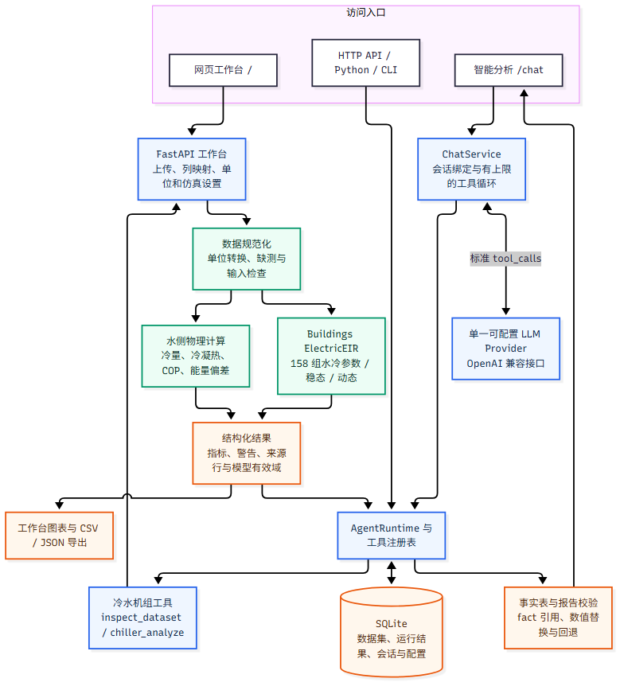
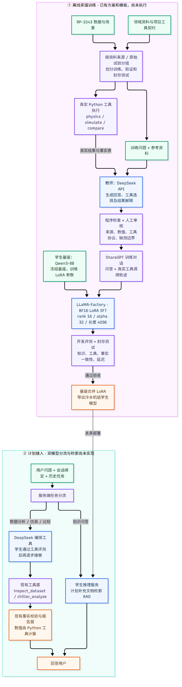

# Chiller Unit Agent · 冷水机组分析智能体

面向冷水机组的数据分析、物理计算与性能仿真的 Python 工程。将 **FastAPI 工作台、Buildings ElectricEIR 数值模型和可调用工具的语言模型 Agent** 连接起来，使自然语言分析有可追溯的计算依据。

无需训练语言模型即可运行工作台；配置兼容模型服务后，可通过聊天调用现有分析工具。

[快速开始](#快速开始) · [项目架构](#项目架构) · [模型蒸馏](#模型蒸馏架构) · [接口与示例](#接口与示例) · [开发验证](#开发验证)

## 当前能力与状态

| 模块 | 能力 | 状态 |
|---|---|---|
| 数据接入 | 手工工况、CSV/XLSX/XLS、工作表选择、列映射与单位转换 | 已实现 |
| 水侧分析 | 制冷量、冷凝热、实测 COP、稳态能量平衡偏差 | 已实现 |
| ElectricEIR | Buildings 13.0.0 方程的 Python 实现，158 组水冷性能记录、自定义曲线、稳态和动态仿真 | 已实现 |
| 模型校准与比较 | 健康稳态单参数功率校准；实测/仿真的 MAE、RMSE、bias 和有效配对数 | 已实现 |
| 智能分析 | 兼容 Chat Completions 的模型连接、工具调用、会话历史、事实引用及报告导出 | 已实现 |
| 持久存储 | 数据集、运行、证据与会话的 SQLite 存储 | 已实现 |
| 专业学生模型 | DeepSeek 教师输出蒸馏、Qwen3-8B LoRA SFT | 方案、配置与格式样例已准备，尚未训练 |
| 双模型分流与 RAG | 学生知识问答、教师工具编排、手册检索 | 规划中，尚未接入 |

当前聊天工具为 `inspect_dataset` 和 `chiller_analyze`，后者支持 `physics`、`simulate`、`compare`。自动训练、校准、优化和设备控制未注册为聊天工具。

## 项目架构



自然语言请求由 ChatService 编排，模型通过标准工具协议选择动作；真实数值由 Python 工具计算。结构化结果携带数据集、来源行、缺测、模型有效域和证据，报告层校验事实引用并替换数值。当前使用一个可配置 Provider，尚无双模型自动分流。

[架构 Mermaid 源码](figures/project-architecture.mmd) · [Agent 详细设计](docs/agent_tool_architecture_2026-10-29.md)

## 快速开始

建议使用 Python 3.11 或 3.12。以下为 Windows PowerShell 命令：

```powershell
git clone https://github.com/agent-Chiller/chiller-unit-agent.git
cd chiller-unit-agent
python -m venv .venv
.\.venv\Scripts\Activate.ps1
python -m pip install -r requirements.txt
python -m uvicorn chiller_app.api.fastapi_app:app --reload --host 127.0.0.1 --port 8000
```

Linux/macOS 激活虚拟环境使用 `source .venv/bin/activate`；其余 Python 启动命令相同。

| 入口 | 地址 |
|---|---|
| 数据与仿真工作台 | http://127.0.0.1:8000/ |
| 智能分析 | http://127.0.0.1:8000/chat |
| OpenAPI 文档 | http://127.0.0.1:8000/docs |
| 服务健康检查 | http://127.0.0.1:8000/health |

工作台可直接使用内置示例，不依赖 RP-1043 原始测量文件。上传文件上限为 10 MB / 20,000 行。

### 配置语言模型

在 `/chat` 页面填写服务商的 Base URL、模型名和 API Key，保存并测试连接。工作台上传数据后点击“转入智能分析”，沿用源单位和当前模型设置。

也可在启动服务的终端设置环境变量：

```powershell
$env:ENERGY_AGENT_LLM_BASE_URL = "https://your-provider.example/v1"
$env:ENERGY_AGENT_LLM_MODEL = "your-enabled-model"
$env:ENERGY_AGENT_LLM_API_KEY = "<在本机填写>"
# 可选：指定本地持久数据目录
$env:ENERGY_AGENT_DATA_DIR = "outputs/energy_agent"
```

`.env.example` 仅为变量说明，应用不会自动加载 `.env`。本项目面向本地单用户；页面保存的模型密钥位于本地数据库中，运行数据目录不应提交到 Git。

## 使用流程

1. 在工作台输入工况、载入示例或上传文件，确认列映射与源单位。
2. 计算水侧指标，或显式选择机组性能记录、设定温度和仿真模式。
3. 查看有效点数、警告、曲线和来源行，按需导出 CSV/JSON。
4. 转入智能分析，让模型检查数据条件、调用工具并解释证据。
5. 保存运行结果或导出 Markdown 报告，复核测量值与模型值的归属。

## 模型蒸馏架构



计划采用 **DeepSeek API 教师 → 有来源的回答及真实工具轨迹 → 程序检查与人工审核 → Qwen3-8B 学生的 BF16 LoRA SFT → 独立评测 → 导出部署**。这是输出级/序列级蒸馏，不是教师 logits 的 KL 蒸馏。

学生学习领域回答、缺测追问、工具选择和结果解释，数值计算继续交给现有工具。计划先让学生处理知识问答，数据分析由教师编排；学生通过工具评测后再逐步接替。RAG 和双模型分流尚未实现。

当前仓库提供训练/导出 YAML、ShareGPT 格式样例和 30 道开发种子题；没有正式训练集、教师调用流水线、训练权重或已验证的学生服务。训练参数为起始模板，服务器环境和效果仍需实际验证。

[完整蒸馏方案](docs/chiller_distillation_2026-11-02.md) · [模板与使用边界](examples/distillation/README.md) · [架构 Mermaid 源码](figures/chiller-distillation-architecture.mmd)

## 数据与模型约定

| 计算目标 | 必要信息 |
|---|---|
| 实测制冷量 | 冷冻水进出温度、冷冻侧流量 |
| 实测冷凝热 | 冷却水进出温度、冷却侧流量 |
| 实测 COP | 实测制冷量、正实测功率 |
| 稳态能量平衡 | 两侧进出温度、两侧流量、同一计量范围的功率 |
| ElectricEIR 仿真 | 两侧进水温度、两侧正流量、设定温度、启停、性能参数 |
| 动态仿真 | 仿真输入及时间设置、连续试验标识、初始状态、时间常数 |

支持温度 K/°C/°F、流量 kg/s/m³/s/m³/h/US gpm、功率 W/kW。源单位需显式提供；同一请求同类量采用相同单位。缺测保持为空，不用模型功率替代实测功率计算“实测 COP”。

工作台默认比热为 4184 J/(kg·K)、密度为 995.586 kg/m³；研究 DataSchema 默认分别为 4180 和 1000。比较结果必须核对实际生效物性。指标中的 `sample_mean` 是有效点均值，不代表时段积分 COP 或总能耗。

动态采用 SciPy BDF，各 `run_id` 独立初始化，组内时间严格递增，不自动排序、去重或插值。ElectricEIR 功率不包含冷站水泵、冷却塔风机等全部用电；性能曲线需与目标机组匹配。残差、曲线越界和规则提示不能独立确诊现场故障。

## 接口与示例

完整接口以运行服务的 `/docs` 为准。

| 接口 | 用途 |
|---|---|
| `GET /workbench/eir/catalogue` | 机组性能记录 |
| `POST /workbench/upload`、`POST /workbench/run` | 文件接入与工作台计算 |
| `POST /model/electric-eir/simulate` | ElectricEIR 仿真 |
| `POST /model/electric-eir/calibrate` | 健康稳态功率校准 |
| `POST /agent/v1/datasets` | 登记可复用数据集 |
| `POST /agent/v1/tools/chiller_analyze/execute` | 执行分析任务 |
| `GET /agent/v1/runs/{run_id}/artifact` | 下载完整运行结果 |
| `POST /agent/v1/chat` | 模型对话与工具执行 |
| `GET /agent/v1/chat/sessions` | 查询历史会话 |

无需语言模型的工具调用演示：

```powershell
python -B -m energy_agent demo --output outputs/agent_stage1_demo.json
```

[JSON 数据集示例](examples/agent_dataset.json) · [物理计算请求](examples/generic_schema_request.json) · [工具 API、Python 与 CLI](energy_agent/README.md) · [聊天运行说明](docs/agent_stage2.md)

`/model/train`、`/model/predict`、`/model/validate` 和 `/model/optimize` 属于性能研究入口，不是语言模型蒸馏训练接口。

## 工程结构

```text
chiller-unit-agent/
├── chiller_app/
│   ├── api/          FastAPI、工作台与应用服务
│   ├── data/         字段映射、单位和清洗
│   ├── model/        水侧物理、ElectricEIR、校准和性能模型
│   ├── diagnosis/    规则检查
│   ├── report/       指标、图表与报告
│   └── web/          工作台与聊天网页
├── energy_agent/     Provider、工具循环、契约、存储和事实报告
├── tests/            数值/API/前端与 Modelica 参考对照
├── research/         ASHRAE 可辨识性、模型比较与残差研究
├── examples/         数据契约及蒸馏配置样例
├── docs/             使用、模型、研究与蒸馏方案
├── figures/          架构图 PNG 与 Mermaid 源码
├── implement-stage/  实施规格与验收记录
├── .env.example      模型连接变量说明
└── requirements.txt  Python 依赖
```

原始试验数据、私人文档、API 密钥、SQLite 数据库、缓存和本地运行输出不随源码发布。研究脚本使用的外部数据需自行取得并按脚本参数配置路径。

## 开发验证

```powershell
python -B -m pytest -q -p no:cacheprovider tests energy_agent/tests
node --check chiller_app/web/app.js
node --check chiller_app/web/chat.js
node tests/test_chart_utils.cjs
node tests/test_chat_ui.cjs
```

Modelica 对照采用仓库内的参考 CSV；重新生成参考结果需要另行安装 OpenModelica 和匹配的 Buildings 库。数值一致性测试不替代目标现场机组验证。

## 文档导航

- [Agent 工具与接口说明](energy_agent/README.md)
- [第二阶段聊天运行说明](docs/agent_stage2.md)
- [Buildings 对齐与适用范围](docs/buildings_alignment.md)
- [物理场景与假设](docs/physical_scenario.md)
- [完整蒸馏方案与实施顺序](docs/chiller_distillation_2026-11-02.md)
- [蒸馏配置与开发题](examples/distillation/README.md)

## 第三方来源

ElectricEIR 方程与性能记录来源及对齐范围见 [Buildings 对齐说明](docs/buildings_alignment.md)，相关许可保留在 [BUILDINGS_LICENSE.txt](chiller_app/model/BUILDINGS_LICENSE.txt)。语言模型及训练资料分别遵循其提供方许可。本仓库未为原创代码指定开源许可证。
