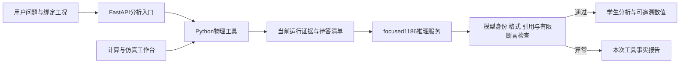

# Chiller Lab 冷水机组物理计算与学生模型分析

Chiller Lab 将水侧物理计算、ElectricEIR 仿真工作台与证据约束语言分析连接起来。**默认智能分析模型为 focused1186：后台先执行 Python 物理工具，再由学生依据本次结果回答。**

学生采用冻结的 Qwen3-8B 基座加一个 LoRA。学生服务异常时显示本次工具事实，不自动调用 DeepSeek 或其他外部模型。外部模型入口保留为用户显式选择的兼容工具调用模式。

[部署学生模型](docs/student_deployment.md) · [物理计算说明](docs/workbench-reference.md) · [API 文档](#接口) · [开发验证](#验证)

## 当前能力

| 模块 | 功能与边界 |
|---|---|
| 数据与计算工作台 | 单条工况、CSV/XLSX/XLS、列映射、单位转换、有效点数和结果导出 |
| 水侧物理计算 | 制冷量、冷凝热、输入功率、实测COP及代数能量平衡偏差 |
| ElectricEIR | 匹配性能曲线下的稳态/动态计算及实测比较，计算由Python完成 |
| 默认学生分析 | focused1186依据当前单行物理计算结果和完整用户问题撰写解释，带可点击事实引用 |
| 异常处理 | 身份、协议、引用或已知物理断言检查失败时显示工具事实；回退不算学生成功 |
| 可选外部模型 | 用户主动切换后，兼容Chat Completions模型可调用数据检查、物理计算、仿真及比较工具 |

学生当前接入范围是**单条物理工况解释**。未把离线解释成绩等同于自主工具规划、动态仿真解释、故障确诊、RAG或跨问题指代能力。计算工作台仍可独立执行多行计算与仿真。

## 项目架构



应用负责绑定数据、执行工具及验证引用；模型负责解释给定结果。推理服务只监听回环地址，远程GPU通过SSH隧道接入本机。模型权重和密钥不进入Git仓库。

## 快速启动计算工作台

应用建议使用Python 3.11。Windows PowerShell：

```powershell
git clone https://github.com/agent-Chiller/chiller-unit-agent.git
cd chiller-unit-agent
python -m venv .venv
.\.venv\Scripts\Activate.ps1
python -m pip install -r requirements.txt
python -m uvicorn chiller_app.api.fastapi_app:app --host 127.0.0.1 --port 8001
```

打开 `http://127.0.0.1:8001/` 使用计算工作台，`http://127.0.0.1:8001/chat` 使用智能分析。工作台不依赖语言模型，可以直接运行合成示例。

默认学生分析需要下文的权重、推理服务和本地凭据；源码中不包含约16 GB的基座或约175 MB的LoRA。该LoRA大小不等于完整模型大小。

## 接入已有 focused1186 备份

备份目录应包含：

```text
<模型根目录>/
  Qwen3-8B/
    config.json
    tokenizer.json
    model-00001-of-00005.safetensors
    ...
  chiller_focused_task_sft_kit_v1/results/
    focused_task_.../adapter_focused_epoch1/
      adapter_model.safetensors
      adapter_config.json
      README.md
```

在项目根目录执行：

```powershell
python -m chiller_student.configure --model-root "<模型根目录>"
python -m chiller_student.service --validate-only
```

第一条创建仅本机使用的 `.student.local.json`，引用原模型路径，不复制或改写权重。第二条全量验证5个基座分片、tokenizer、配置与适配器哈希，不加载GPU、不训练。凭据若不存在会生成本机文件，已有凭据不会覆盖；不要把内容粘贴到聊天或GitHub。

GPU服务支持显式指定 `--model-dir` 与 `--adapter-dir`，无需复制Windows目录结构。完整的GPU启动、SSH隧道和本机应用命令见[部署说明](docs/student_deployment.md)。

本机是否可直接运行取决于硬件。当前保留的BF16基座/FP32 LoRA和严格数学执行配置按原GPU环境加载；4 GB显存的笔记本不适合直接运行该配置。本机可以运行页面及物理计算，GPU服务器只提供学生推理。没有静默量化、CPU降级或改换权重。

## 学生模型身份与训练

| 项目 | 冻结值 |
|---|---|
| 模型 | Qwen3-8B＋focused1186单LoRA |
| 基座revision | `b968826d9c46dd6066d109eabc6255188de91218` |
| 最终适配器SHA-256 | `136eeeb15c1751b8a32628fc525ba680e783e3bf1cbbc546e54a64ab00eca8ab` |
| LoRA | r=16，alpha=32，dropout=0.05 |
| 最后一轮 | 815条训练记录，1186次加权更新；从已保留适配器继续训练 |
| 推理 | 非思考原生聊天模板、greedy、最多2048新token、单适配器、不合并权重 |

训练使用教师辅助编辑参考的答案级监督，没有教师logits或KL蒸馏；物理公式由Python执行，不是神经网络物理残差损失。训练、选模和评测历史保留在本地归档，不作为运行应用的依赖。

本批120题回顾性比较中，学生内容正确且完整通过117/120；该成绩来自非盲助手初审，8个共享基础工况，不能作为独立专家认证、跨设备泛化或完整Agent上线验收。软件回归通过也不代表模型每次回答正确。

## 数据与物理约定

- 源单位显式绑定；工作台支持K/°C/°F，kg/s、m³/s、m³/h、US gpm，W/kW。学生入口当前接受kg/s、m³/h、US gpm的单行物理输入。
- Qe取冷冻侧进水减出水温差，Qc取冷却侧出水减进水；COP要求有效正输入功率；R=Qc−Qe−P。
- 缺测不补零，控制目标不替代实测值，代数残差不能单独确诊故障。
- 实际比热、密度、映射和单位以本次运行记录为准。密度仅用于体积流量转换。
- ElectricEIR需匹配机组性能曲线；动态模式与实测比较使用工作台入口，不因学生物理分析接入而视为已验证语言能力。

## 接口

| 接口 | 用途 |
|---|---|
| `GET /health` | 本机应用健康 |
| `POST /workbench/run` | 物理计算/仿真工作台 |
| `POST /agent/v1/datasets` | 注册带映射和源单位的数据集 |
| `GET /agent/v1/analysis/config` | 当前focused1186配置及冻结身份，不暴露密钥 |
| `POST /agent/v1/analysis` | 默认学生：真实Python计算后生成解释 |
| `GET /agent/v1/chat/sessions` | 会话与报告历史 |
| `GET /agent/v1/runs/{run_id}/artifact` | 核对本次原始计算产物 |
| `POST /agent/v1/chat` | 默认学生入口，与`/analysis`采用相同计算先行流程 |
| `POST /agent/v1/chat/external` | 显式外部Provider工具调用路径，需要用户自行配置 |

旧学生选择器/解释开发接口保留用于历史兼容，页面不再将80步选择器当作默认语言模型。默认学生分析失败不会自动转向外部Provider。全部接口以运行服务的 `/docs` 为准。

## 目录

```text
chiller_app/       计算、仿真、数据接入与网页
energy_agent/      会话、工具、证据绑定及学生应用接入
chiller_student/   精简的冻结推理、输入协议及有限检查
deployment/      公开的模型身份与预期文件哈希
scripts/          应用、GPU服务及SSH隧道启动入口
examples/         合成数据及API调用示例
tests/            物理模型和页面回归
```

历史研发脚本与报告已从应用源目录归档到本机 `outputs/archive/`。原始数据、训练评测输出、论文、凭据、模型权重和缓存不提交到GitHub。第三方数据的使用及再分发须按其实际条款处理；当前仓库不发布RP-1043原始测量表。

## 验证

```powershell
python -m pytest energy_agent/tests tests -q
node tests/test_chat_ui.cjs
node tests/test_chart_utils.cjs
```

软件测试使用真实Python计算和标明为合成的模型传输夹具，不调用付费API，不代表GPU端到端验收。部署完成后还应保存真实 `service_ready.json`，在页面核对当前运行引用、学生身份及回退状态。
