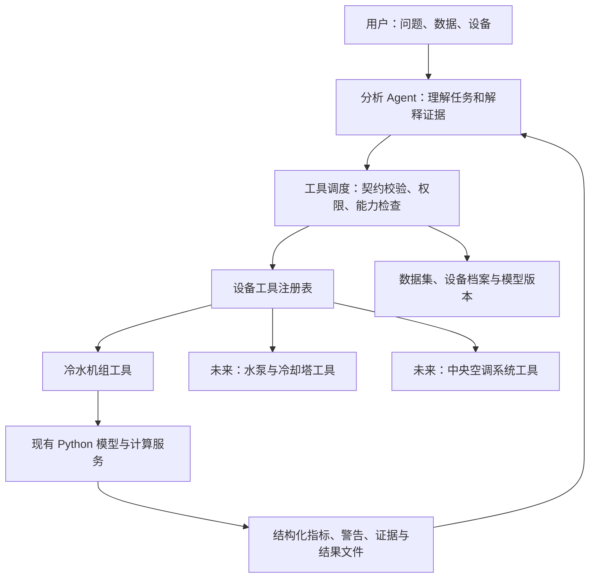

# 冷水机组 Agent 工具化：可行性与实施方案

日期：2026-10-29。本文包含架构设计及第一阶段实现状态。`energy_agent/` 已实现冷水机组工具、持久数据集引用、统一结果及Python/CLI/HTTP入口；外部大模型连接与对话属于后续阶段。当前实际接口以 energy_agent/README.md 为准。

## 1. 结论与范围

建议建设一个面向暖通设备的分析 Agent，将现有项目作为首个冷水机组工具接入。工程上可行，已有 Python 模型、Pydantic 数据契约和 FastAPI 接口可以复用。第一阶段以运行数据分析、能效计算、工况仿真和证据解释为目标。

Agent 负责理解需求、补齐任务条件、选择工具和解释证据；Python 服务负责数据处理、物理计算、模型求解和统计。新增对话能力不要求重新训练现有机组模型，也不要求微调大语言模型。目标机组性能曲线的选取与校准仍是独立工作。

需要分别管理两类“模型”：一类是理解语言的大模型提供商及其版本；另一类是 ElectricEIR、性能回归、未来泵/冷却塔模型及其设备参数版本。两类注册信息不能混用。

## 2. 已有能力与现场使用边界

| 能力 | 现有实现 | 工具化判断 |
|---|---|---|
| 列映射、温标、流量和功率单位 | `chiller_app/data/schema.py` | 可复用；进入工具前固定数据契约和单位 |
| 文件接入 | `/agent/v1/datasets/upload` | 可解析 CSV/XLSX/XLS并选择工作表，返回持久化dataset_id |
| 实测水侧冷量、冷凝热、COP、能量偏差 | `run_workbench(operation="calculate")` | 适合作为第一版主能力；允许缺测并保留来源行号 |
| ElectricEIR 稳态/动态仿真 | `/model/electric-eir/simulate` | 适合封装；明确性能记录、适用范围、初态及时间规则 |
| 规则提示 | `diagnosis/rules.py`、工作台 warnings | 可用于异常线索和检查建议；不足以唯一确定故障原因 |
| ElectricEIR 校准 | `/model/electric-eir/calibrate` | 当前是健康稳态数据上的单参数功率校正；健康和稳态由调用方提供依据 |
| 性能训练、预测和验证 | `/model/train`、`predict`、`validate` | 可作为后续独立能力；先增加受管模型注册与数据划分记录 |
| 优化建议 | `model/optimization.py` | 原型能力；要求可调量已进入模型，具备边界和基准工况 |
| 冷站/中央空调全系统分析 | 尚未形成系统模型 | 需要补设备模型、拓扑和系统约束；不能仅新增工具名称就视为完成 |

本次执行的核验：

- 使用 FastAPI TestClient 调用 `/workbench/run`，显式指定 cp=4180 J/(kg·K)、密度=1000 kg/m³，10/5°C、30/35°C、72/90 m³/h、100 kW 工况得到冷量 418 kW、COP 4.18、能量偏差 4.5 kW。
- 同一工况不映射流量后，冷量和 COP 均为 null。
- 调用 `/model/electric-eir/simulate` 的稳态分支，在指定输入下得到正功率和模拟 COP；未提供实测功率时，实测 COP 仍为 null。
- `F:/Anaconda/envs/modelica/python.exe -B -m pytest -q -p no:cacheprovider tests/test_reference_alignment.py`：2 passed。该检查复算现有参考文件的动态/稳态对照及事件对齐，没有重新运行 OpenModelica 编译器。

`artifacts/eir_validation/alignment_report.json` 已记录指定参数记录、11 个采样时刻及相应启停/负荷场景下的对照通过。当前 README、模型说明和工作台 notes 已同步这一有限范围结论。已有对照支持这组参考场景的实现一致性，不能替代真实机组适配验证。

现有 ASHRAE 研究结果也表明需要限制诊断结论：`artifacts/ashrae_fault_residual_test.json` 中，所选稀疏线性功率残差对部分选定故障文件没有检出；这项探索实验不能支持通用故障定位能力。旧分类器和当前 ElectricEIR 工具应分别登记来源、输入和验证范围。

## 3. 推荐架构



第一版采用 Python + FastAPI + Pydantic + 原生工具调用 + 轻量状态机。先在同一部署中增加 Agent 模块和工具适配层，复用现有代码；远程部署或独立扩容后，再让适配层通过 HTTP 调用模型服务。

同一部署不要求 Agent 绕 HTTP 调用自身，也不应直接复制模型代码。建议逐步提取稳定的应用门面，由网页、HTTP API 和工具适配器共同使用。`workbench.py` 当前混合了请求模型、路由和业务编排，适配时应保留运行语义，避免将路由函数作为长期领域接口。

单 Agent 足以承担第一阶段的选择、执行和解释工作。设备工具数量增加，首先扩展注册表和能力描述；确有独立任务、权限或运行周期时，再考虑多个 Agent。

## 4. 三种接口形式如何选择

| 形式 | 在本项目中的用途 | 建议 |
|---|---|---|
| Python 函数工具 | 自建 Agent 调用本地适配器，适配器调用模型服务 | 第一阶段采用，接入链路最短 |
| FastAPI HTTP 接口 | 前后端、远程服务及不同部署之间复用 | 保留现有接口；需要时作为工具的内部传输 |
| MCP Server | 将同一工具交给支持 MCP 的外部客户端发现和调用 | 有外部接入需求时增加薄适配层 |

函数调用、HTTP 和 MCP 是不同层次的接口，可以共用一套领域逻辑。MCP 提供客户端接入与工具协议；设备分析流程、缺测判断和物理求解仍由应用实现。

如果采用 OpenAI，可通过 Responses API 的 function calling 接入，并对工具参数启用 strict schema。strict 约束的是结构，不会证明温标、流量、机组型号或工况在物理上正确；应用层仍需校验。OpenAI Agents SDK 也可承担运行循环，但领域服务应通过适配器隔离对特定 SDK 的依赖。

## 5. 将本项目作为一个设备工具接入

对 Agent 暴露一个主工具 `chiller_analyze`，内部使用受控任务枚举，组织现有多个接口。第一版建议仅开放 `physics`、`simulate`、`compare`，训练、校准和优化分别在后续版本开放。

第一阶段实际调用契约如下，仿真设置通过simulation对象显式提供：

```json
{
  "name": "chiller_analyze",
  "arguments": {
    "asset_id": "chiller_01",
    "dataset_id": "dataset_001",
    "task": "physics",
    "simulation": null,
    "preview_rows": 5
  }
}
```

字段约定：

- `asset_id`：设备身份及受管设备档案。身份访问范围由服务端会话决定。
- `dataset_id`：已接入、带版本和列映射/单位信息的数据集。手动工况也创建小型数据集。
- `task`：明确枚举，禁止任意函数名、代码或命令。
- `simulation.record_id`：显式选择当前目录中的ElectricEIR记录，或以custom关联自定义参数；完整参数固化在运行metadata中。健康校准模型管理留待后续。
- `simulation`：仿真时提供模式、设定温度、启停、时间设置和初态；physics任务为空。compare只接受series并按源行配对。

不将任意服务器文件路径、任意模型文件或任意 HTTP 地址作为 Agent 工具参数。现有服务使用 `model_path` 和 joblib 载入模型，集成时由服务端注册表解析可信模型 ID。租户、用户和权限上下文由执行器注入，不能由大模型生成后直接采信。

原始文件和完整时间序列留在数据服务中。大模型通常只接收字段摘要、缺测统计、聚合指标、异常区间及结果文件 ID，避免把大量记录来回写入上下文。确需查看明细时，通过受限分页或片段查询获取。

注册表为每个工具声明：名称、版本、设备类型、任务枚举、输入/输出 schema、字段依赖、单位、适用工况、运行成本、超时和结果状态。数据集查询、设备列表和任务结果查询可作为所有设备共用的基础能力。

## 6. 工具内部必须执行的流程

```text
解析设备和数据引用
→ 验证字段映射、源单位和数据质量
→ 按所选任务检查必要输入
→ 解析受管模型与适用范围
→ 执行物理计算/仿真/比较
→ 计算汇总、定位警告区间并保存完整结果
→ 返回带证据的结构化摘要
```

执行器必须强制执行前置条件，不能仅在提示词里要求 Agent 自觉遵守。缺少部分指标输入时返回 `partial` 和缺测项；整个任务无法执行时返回 `needs_input` 或 `unsupported`。数值求解失败返回明确错误，不能用自然语言补出结果。

| 任务或指标 | 必要条件 |
|---|---|
| 实测冷量 | 冷冻水进出温度、冷冻侧流量、固定水物性 |
| 实测 COP | 实测冷量条件，以及同一计量范围的正实测功率 |
| 实测冷凝热 | 冷却水进出温度、冷却侧流量 |
| 稳态能量偏差解释 | 两侧量及功率、计量范围和测点同步；需要稳态依据才能作为稳态异常线索 |
| ElectricEIR 稳态仿真 | 两侧进水温度、两侧正流量、设定温度、启停及匹配的性能参数 |
| ElectricEIR 动态仿真 | 稳态输入条件，另加可信时间顺序或明确采样间隔、分段标识、初态和时间常数 |
| 实测/模型残差 | 模型有效、独立的实测比较对象及对齐规则；没有实测值只能给模拟结果 |
| 校准 | 有依据的健康数据、适当稳态/动态条件、训练划分和独立验证记录 |

设备档案或文件元数据已提供可靠单位时直接复用；字段缺失或有歧义时，给出具体补充项。大模型可以建议列映射，但不能自行编造流量、设备型号、健康标签或稳态证明。现有校准接口的确认布尔值不能由 Agent 无依据地设为 true。

长仿真、校准和训练任务应转为可查询任务，返回 `job_id`，支持超时、取消和明确失败状态。短请求先同步执行；有长任务需求时加入独立 worker 和任务存储。对重试使用幂等键，避免重复创建训练/校准版本。FastAPI 的轻量 BackgroundTasks 不能代替需要持久状态与故障恢复的完整任务系统。

## 7. 统一工具输出

建议公共结果包含以下信息，具体字段在实现时用 Pydantic 固定：

```json
{
  "status": "success | partial | needs_input | unsupported | failed",
  "request_id": "...",
  "asset_id": "...",
  "dataset_id": "...",
  "dataset_version": "...",
  "model_id": null,
  "model_version": null,
  "metrics": {},
  "findings": [],
  "missing_inputs": [],
  "warnings": [],
  "assumptions": [],
  "evidence_refs": [],
  "artifact_ids": []
}
```

`metrics` 中每项应包含值、单位、来源类别（实测派生/模型预测）、有效样本数、时间范围和聚合定义。`findings` 应区分事实、异常线索和候选解释，并关联来源行、时间窗或模型输出。没有校准依据时，不输出凭空生成的“故障概率 95%”。

同一模型和输入的计算结果应可重复。记录有效物性、列映射、数据清洗策略、参数摘要、曲线越界比例和模型验证范围。Agent 的最终报告必须保留会影响结论的缺测和越界信息。

## 8. 本项目封装前需要统一的工程问题

1. **模型路由**：当前仿真仅保留 `/model/electric-eir/simulate` 和工作台中的 ElectricEIR。`/models` 仅列出该仿真模型；后续由注册 ID 选择机组参数及设备模型。
2. **数据清洗语义**：旧 `prepare_records` 调用 `clean_measurements`，会排序时间并默认去重；工作台保留来源顺序，动态仿真要求组内时间递增。统一为显式清洗策略，输出前后行数和原因，避免分析与仿真看到不同序列。
3. **物性及其传播**：工作台默认 cp=4184、密度=995.586，旧数据 schema 默认 cp=4180、密度=1000；部分旧服务计算直接采用内部默认常数。适配层须固定并传递实际生效物性，不能只改请求中的 schema 就声称全链路统一。
4. **能力检查**：`/data/validate` 的动态字段检查已改为 ElectricEIR 的进水温度、正流量及设定值字段。字段存在仍不等于数值完整、时间有效或曲线适用，工具层需实现任务级校验器。
5. **规则含义**：旧诊断与工作台采用不同阈值/分母。应把规则版本、阈值、适用模式和计量边界写入结果；瞬态储热不直接作为稳态失衡故障证据。
6. **模型与文件管理**：现有 model_path 改为受管 ID；增加参数版本、适用设备、校准来源和验证范围。普通分析与模型训练/发布分别管理。
7. **数据和运行持久化**：第一阶段已实现SQLite数据集和分析运行，源记录与完整输出可查询；asset_id在登记与调用间强制匹配。独立设备档案和异步job_id留待后续。
8. **说明状态同步**：当前文档和界面说明已同步参考对照状态；后续将验证状态与模型注册版本关联，供页面和 Agent 共同读取。

## 9. 扩展到中央空调

新增工具的统一点是任务、状态、单位、证据和版本管理；不同设备仍应拥有独立输入 schema。冷水机组字段不能成为所有暖通设备的通用字段表。

建议分层扩展：冷水机组 → 冷站（机组、水泵、冷却塔与管路）→ 中央空调（冷站、AHU/末端、建筑负荷与室内环境）。具体组件按项目范围逐步接入。

必须区分两种能力：

- **设备分析编排**：分别执行已有工具并汇总异常和能耗，可较早交付。
- **耦合仿真及系统优化**：需要设备拓扑、质量/能量守恒、流量和温度边界、控制约束及时间步协调，必须独立建模和验证。不能靠大模型将几个 COP 文本相加得出。

冷站能效应使用同一边界、同时段的有效供冷与总耗电：

```text
COP_plant = Q_delivered / (P_chillers + P_pumps + P_towers + other_in_scope_power)
```

时段能效应按能量比计算，而非对逐点 COP 求简单平均：

```text
COP_period = integral(Q_delivered dt) / integral(P_total dt)
```

需声明计量边界、有效时段、缺失覆盖率、时间对齐和积分规则。节能场景比较还需在相同供冷任务、环境条件和舒适约束下进行。现有 ElectricEIR 功率主要是机组模型功率，不包含整套系统辅助设备耗电。

## 10. 实现状态与后续顺序

第一阶段实际模块、命令和API见 [energy_agent/README.md](../energy_agent/README.md)。实现决策、逐级验收与审查记录见 `implement-stage/`。现有 `chiller_app` 数值服务与网页继续复用。

第一阶段：已实现冷水机组工具、不可变数据集引用、统一结果与证据，并复用相同数值边界。保留实际物性与清洗规则，支持缺流量、显式单位、时间重复拒绝、越界标记和实测/模拟分离。具体测试及审查状态以实施记录为准。

第二阶段：增加对话入口和有上限的工具循环，支持识别任务、选择设备、运行计算、展示证据、处理缺测和继续追问。先用固定工具结果测试解释，再接实际大模型测试路由。验收每个数值结论能追溯，必要步骤由执行器保证；记录调用成功率、延迟、成本和失败原因。

第三阶段：接入健康基线、残差比较、版本化校准及长任务。按独立试验/日期划分评估，防止将测试故障数据校准进健康模型。训练、校准和默认模型替换不纳入普通问答的隐式动作。

第四阶段：加入水泵/冷却塔，并用同一注册机制和结果契约验证扩展成本；之后再实施拓扑及系统耦合。外部客户端需要复用时增加 MCP 适配。

第一版验收用例至少包括：正常能效分析、缺流量、仅有模拟量、机组曲线不匹配、动态启停、时间戳不合法、设备引用不存在、求解失败，以及用户只要求分析时不触发训练或控制动作。第一阶段验收覆盖工具与数据链路；自然语言路由及对话评测属于第二阶段。

## 11. 官方技术依据

- [OpenAI Function calling](https://developers.openai.com/api/docs/guides/function-calling)：工具 schema、调用及结果返回流程、strict 结构约束。
- [OpenAI Agents SDK](https://developers.openai.com/api/docs/guides/agents/sdk)：应用内运行 Agent 循环及工具集成的可选框架。
- [OpenAI MCP server 概念](https://developers.openai.com/plugins/concepts/mcp-server)：MCP 工具发现与外部客户端接入。
- [FastAPI Background Tasks](https://fastapi.tiangolo.com/tutorial/background-tasks/)：轻量背景任务及重计算的部署考虑。

本文的架构选型、设备能力边界和分阶段顺序，是结合本地项目实现作出的工程判断。
