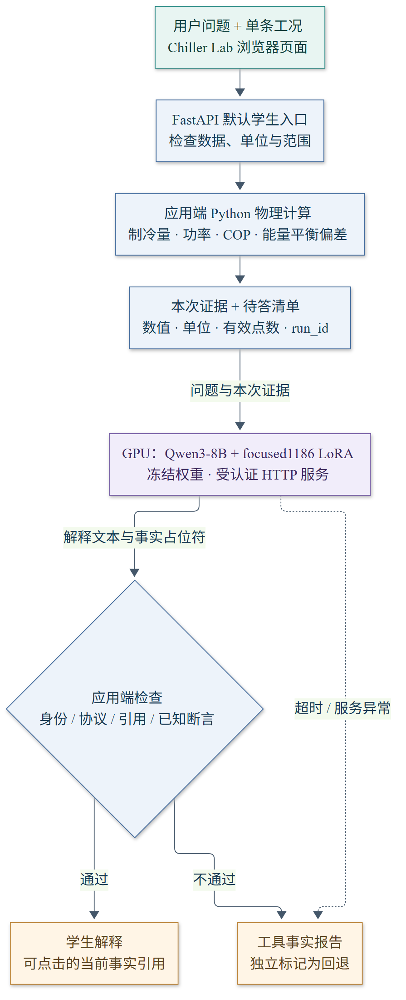
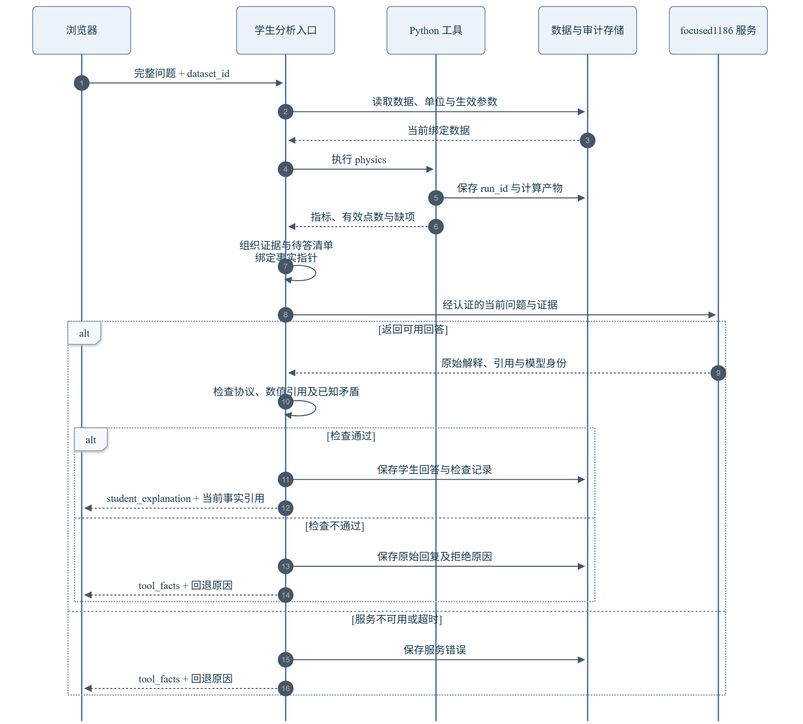
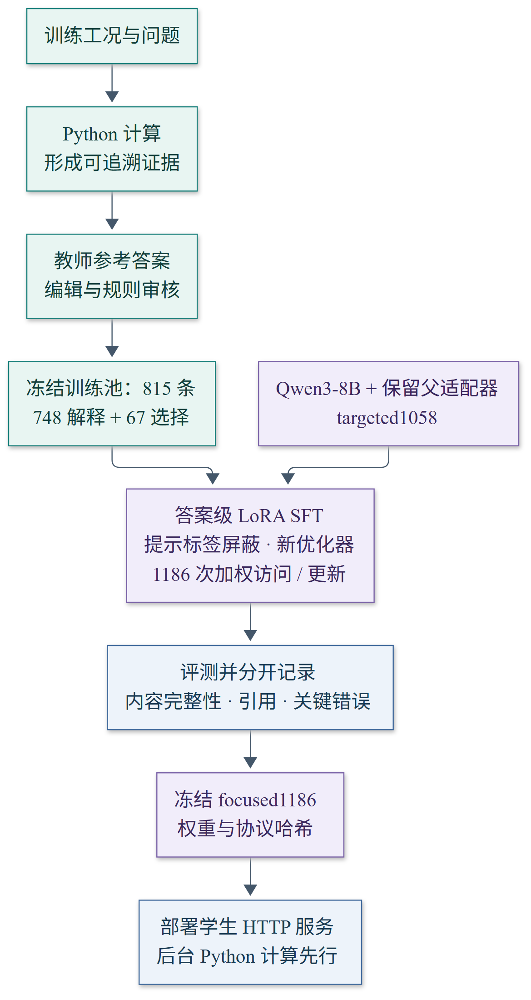

# 架构与代码对应关系

## 1. 默认路径：Python先计算，学生解释

浏览器与本机FastAPI应用负责输入、物理计算、数据存储和展示。GPU推理服务加载Qwen3-8B基座及一个focused1186适配器。二者可以位于同一台机器，也可以经SSH隧道连接；应用端无须安装Torch。

| 步骤 | 源码 | 作用 |
|---|---|---|
| 页面 | `chiller_app/web/` | 工况录入、图表、学生与外部模式选择、事实引用 |
| 默认API | `energy_agent/api/focused_analysis.py`、`api/chat.py` | `/analysis`和默认`/chat`路由至学生 |
| 当前配置 | `energy_agent/config/student_focused.py`、`deployment/focused1186.json` | 固定模型身份、协议和哈希，读取连接配置 |
| 执行编排 | `energy_agent/agents/student_explanation.py` | `StudentExplanationService._analyze`先调用physics，再组织问题与证据 |
| 公共工具 | `energy_agent/runtime.py`、`tools/chiller/tool.py`、`tools/chiller/backend.py` | 调用Python计算，返回结构化ToolResult |
| 计算内核 | `chiller_app/model/physics_model.py`、`electric_eir.py` | 水侧公式与ElectricEIR模型；学生默认路径使用前者 |
| 证据与任务 | `chiller_student/evidence_explanation.py`、`focused_contract.py`及依赖协议模块 | 从当前计算产生事实，编译待答任务 |
| 请求提供者 | `energy_agent/providers/student_explanation.py` | HTTP认证、服务身份与请求绑定检查 |
| GPU服务 | `chiller_student/service.py` | 加载与核验冻结权重，响应受限Chat Completions请求 |
| 输出检查 | `chiller_student/focused_output.py`、`explanation_protocol.py`、`typed_physics_claims_v3.py` | 协议、事实数值引用及部分已知矛盾检查 |
| 持久存储 | `energy_agent/storage/repository.py`、`storage/chat.py` | 数据集、工具运行、会话、原始回复及审计 |

上表中的`api/`、`tools/`、`storage/`短路径均相对于`energy_agent/`。各模块存在历史版本兼容依赖，应按实际导入关系维护，不能按文件日期直接删除。

## 2. 一次请求如何完成

用户提交完整问题与已登记的单行数据集。应用检查范围与会话绑定，再执行`runtime.analyze(... task='physics')`。工具产物先保存，随后事实逐项绑定其`run_id`、`dataset_id`和JSON Pointer；`bind_planned_facts`检查这些指针指向的值确实属于本次产物。

学生返回自然语言解释模板，例如使用`{{fact:F3}}`引用制冷量。程序只把经过核对的当前事实填入模板，再渲染成可点击引用。指标值、有效点数、总行数属于不同事实，不可互换。

- `report_mode=student_explanation`：学生正文通过当前有限检查并展示。
- `report_mode=tool_facts`：连接、身份、格式或检查失败后展示Python事实；不计学生回答成功。
- 范围检查可能在模型调用之前拒绝请求；不支持的知识、动态仿真或故障确诊请求不会自动转发外部模型。
- 当前默认路径`teacher_calls=0`，不把服务失败转换成DeepSeek调用。

自动检查不是完整自然语言语义证明；内容正确性、任务是否漏答仍需专门评测。`status=limited`等开发标识也不是“接口失败”的同义词，应结合报告模式、错误码和当前事实判断。

## 3. 显式外部模型路径

`POST /agent/v1/chat/external`进入`energy_agent/agents/chat.py`。该路径把允许的工具描述交给OpenAI兼容Provider，允许模型在受限循环中选择工具。它与默认学生“后台固定physics → 解释”的执行方式不同。

外部路径能使用数据检查、物理计算、仿真和比较工具。工具执行仍由Python完成，不把大模型计算结果作为物理公式的替代。外部模型配置、连通性测试和请求可能产生API费用，只有用户显式选择后才调用。

作者提供的[tu0.1](../figures/paper/tu0.1.png)展示通用工具调用循环；[tu0.2](../figures/paper/tu0.2.png)展示路径和学生适配的关系。不能将通用循环图解释为focused1186已独立决定任意工具调用。

## 4. 离线训练和在线服务

离线使用训练问题、Python证据、教师参考和编辑审核形成答案级监督数据，训练LoRA。最终focused1186继承保留父适配器，在815条训练池上完成1186次加权更新；推理只加载一个最终适配器。

公开历史训练源码位于`research/focused1186_sft/`，使用当时的`student_tools`命名空间。当前应用移植的必需依赖位于`chiller_student/`，原始文件来源记录在`migration_origins.json`。训练代码、软件回归检查和GPU服务分别使用各自入口。

训练样本正文、原始测量表、最终评测输入和权重未随本次仓库发布。历史包保留清单和哈希，缺少受控材料时预检应停止；详见[研究源码复现说明](research_reproduction.md)。

## 5. 当前范围与下一步

当前接入目标是单条水侧物理分析，不等于完成全部DeepSeek功能替换。扩大到多行时间序列、动态仿真解释、知识检索或自主工具规划时，需要相应协议、训练证据、独立任务评测与页面验证。

软件回归覆盖执行与回退行为；模型回答质量需要使用另行保存的题库评估。真实GPU部署仍应按[部署说明](student_deployment.md)核对身份、运行记录和实际回答。
