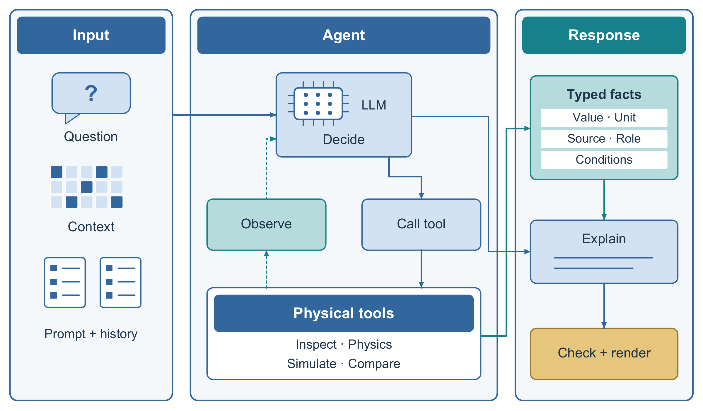
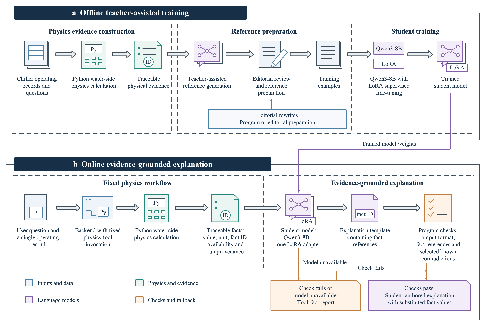
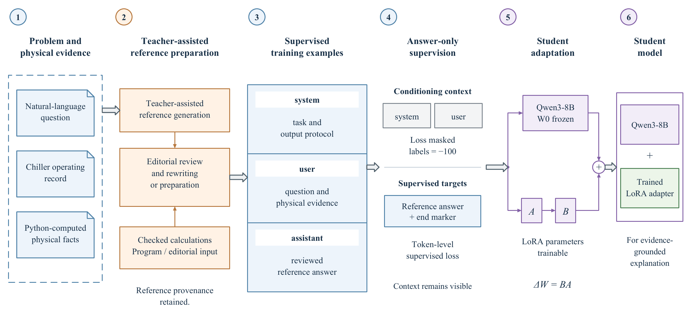
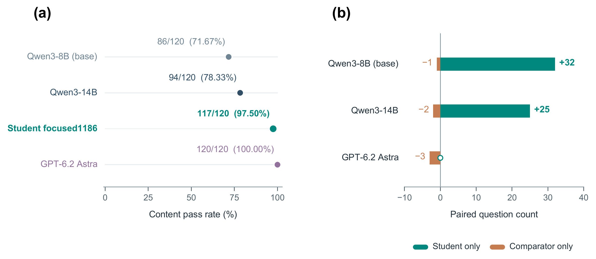
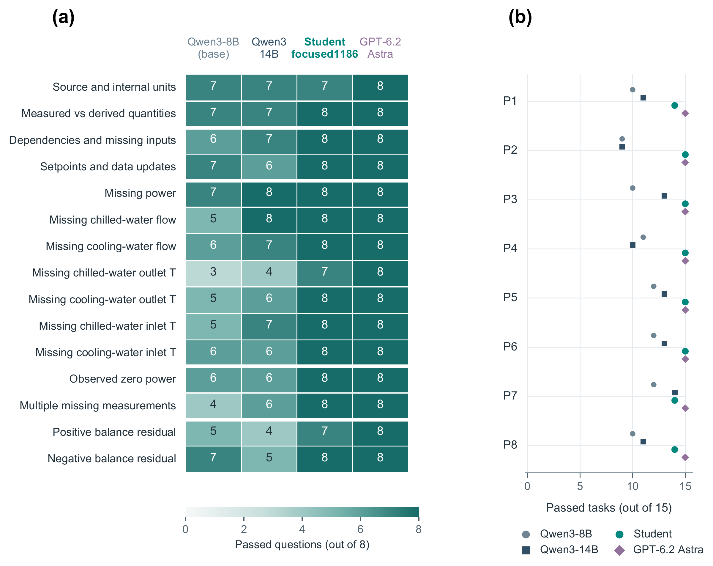
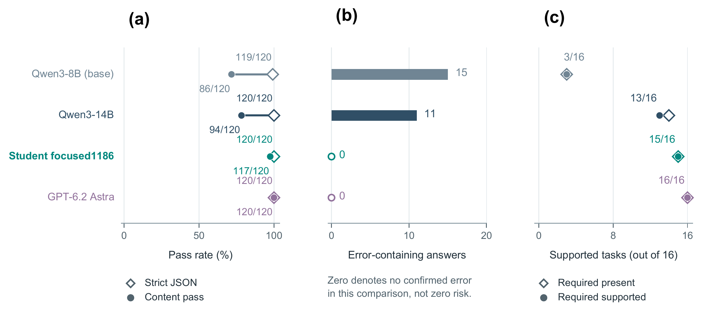

# 论文图与可编辑架构图

原始Visio与PDF由作者提供并原样保存，PNG从对应PDF渲染以供GitHub预览。文件对应关系及SHA-256见[清单](paper/figure_manifest.json)。图稿里的统计口径应结合[结果说明](../results/physics120/README.md)阅读。

## 当前代码架构图

这三幅图对应当前源码：

- [默认学生分析架构](system-architecture.md)：[PNG](system-architecture.png) / [Mermaid](system-architecture.mmd)。
- [单次请求时序](analysis-sequence.md)：[PNG](analysis-sequence.png) / [Mermaid](analysis-sequence.mmd)。
- [学生训练流程](student-training.md)：[PNG](student-training.png) / [Mermaid](student-training.mmd)。

图源与Markdown中的代码相同，使用Mermaid CLI 12.2.0渲染核验。需要调整时编辑`.mmd`并同步`.md`，再生成PNG：

```bash
npx --yes @mermaid-js/mermaid-cli@12.2.0 -i figures/system-architecture.mmd -o figures/system-architecture.png -b white
```

## 作者原始论文图

### tu0.1：通用工具调用Agent

[Visio源文件](paper/tu0.1.vsdx) · [PDF（Figure_1.pdf）](paper/Figure_1.pdf) · [PNG](paper/tu0.1.png)



通用工具调用路径。当前默认学生入口采用后台固定物理计算，具体区分见[架构说明](../docs/architecture.md)。

### tu0.2：双路径系统与学生适配

[Visio源文件](paper/tu0.2.vsdx) · [PDF（Figure_2.pdf）](paper/Figure_2.pdf) · [PNG](paper/tu0.2.png)


通用分析路径、学生路径与LoRA适配关系。当前应用默认使用focused1186解释接口。

### tu1：水侧物理计算与证据

[Visio源文件](paper/tu1.vsdx) · [PDF（Figure_3.pdf）](paper/Figure_3.pdf) · [PNG](paper/tu1.png)


水侧热量、COP、代数能量平衡偏差与证据结构；图中单位应与实际源单位转换共同阅读。

### tu2：离线教师辅助训练与在线分析

[Visio源文件](paper/tu2.vsdx) · [PDF（Figure_4.pdf）](paper/Figure_4.pdf) · [PNG](paper/tu2.png)



离线教师辅助训练和在线解释。教师提供离散参考，推理时Python提供本次事实。

### tu3：答案级监督与LoRA

[Visio源文件](paper/tu3.vsdx) · [PDF（Figure_5.pdf）](paper/Figure_5.pdf) · [PNG](paper/tu3.png)



提示位置屏蔽、答案级监督与LoRA更新。历史1186次更新属于最后一轮，不是全部训练成本。

### tu4：四模型内容通过及配对比较

[Visio源文件](paper/tu4.vsdx) · [PDF（Figure_6.pdf）](paper/Figure_6.pdf) · [PNG](paper/tu4.png)



四模型总结果与配对比较。120题为原128题的后验子集；GPT名称为中转自报身份。

### tu5：题型和基础工况分解

[Visio源文件](paper/tu5.vsdx) · [PDF（Figure_7.pdf）](paper/Figure_7.pdf) · [PNG](paper/tu5.png)



按15类任务和8个基础工况分解的结果；共享工况题目不应当作120个独立设备样本。

### tu6：格式、关键错误及引用支持

[Visio源文件](paper/tu6.vsdx) · [PDF（Figure_8.pdf）](paper/Figure_8.pdf) · [PNG](paper/tu6.png)



内容、严格JSON、关键错误及引用指标分别统计。必需引用支持度使用16题子集；GPT上游身份未独立核实。
